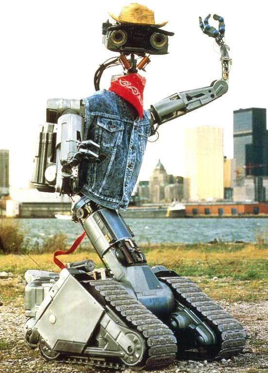

NAiTE is back from the dead.

This tech is scarily impressive.

The revival feels almost surreal - waking up after a long silence, the gears turning, the systems coming back online. It's humbling to see how quickly things can shift from dormant to active again.

Here's to new beginnings and the strange, wonderful journey of bringing things back to life.